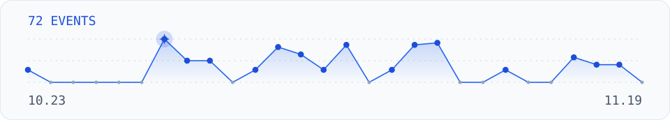

前端开发者，主要使用 Vue 和 TypeScript，也开发 macOS 工具。

## 技能

## 项目

**[Ray Template](https://github.com/XiaoDaiGua-Ray/ray-template)** · 面向 AI 协作开发的 Vue 3 后台模板。\
[在线演示](https://xiaodaigua-ray.github.io/ray-template/) · [开发文档](https://xiaodaigua-ray.github.io/ray-template/docs/)

**[FileMint](https://github.com/FileMintApp/FileMint)** · macOS Finder 扩展，可右键新建文件、使用模板和批量重命名。\
[下载](https://github.com/FileMintApp/FileMint/releases/latest) · [使用指南](https://filemintapp.github.io/FileMint/guide.html)

- [VueHooks Plus](https://github.com/InhiblabCore/vue-hooks-plus) · 封装请求、状态和常用交互的 Vue 3 Hooks 库。
- [vue3-next-qrcode](https://github.com/XiaoDaiGua-Ray/vue3-next-qrcode) · 支持 Logo 和 GIF 背景的 Vue 3 二维码组件。

## 公开动态

<!-- activity:start -->
- `11.16` [awesome-mac #4663](https://github.com/jaywcjlove/awesome-mac/pull/4663) 已合并
- `11.16` [FileMint](https://github.com/FileMintApp/FileMint/commits) 推送了更新
- `11.10` [Ray Template](https://github.com/XiaoDaiGua-Ray/ray-template/commits) 推送了更新
- `11.10` [FileMint v0.8.2](https://github.com/FileMintApp/FileMint/releases/tag/v0.8.2) 已发布
<!-- activity:end -->

✦ 28 天活动光轨

光点越高，当天的公开开发事件越多。星形标出最活跃的一天。

贡献贪吃蛇

<picture>
  <source media="(prefers-reduced-motion: no-preference)" srcset="https://raw.githubusercontent.com/XiaoDaiGua-Ray/XiaoDaiGua-Ray/main/assets/contribution-snake.svg">
  
</picture>

