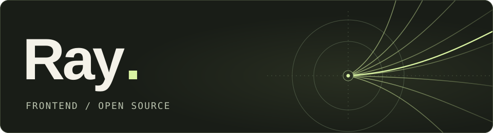

前端开发者，主要使用 Vue 和 TypeScript，也开发 macOS 工具。

## 代表作品

**[Ray Template](https://github.com/XiaoDaiGua-Ray/ray-template)** · Web\
面向 AI 协作开发的 Vue 3 后台模板，提供可运行的组件示例和按任务组织的开发指引。

**[FileMint](https://github.com/FileMintApp/FileMint)** · macOS\
在 Finder 的右键菜单里新建文件、套用模板，也可以批量重命名。

### Vue 生态

- [VueHooks Plus](https://github.com/InhiblabCore/vue-hooks-plus)：封装请求、状态和常用交互的 Vue 3 Hooks 库。
- [vue3-next-qrcode](https://github.com/XiaoDaiGua-Ray/vue3-next-qrcode)：支持 Logo 和 GIF 背景的 Vue 3 二维码组件。
